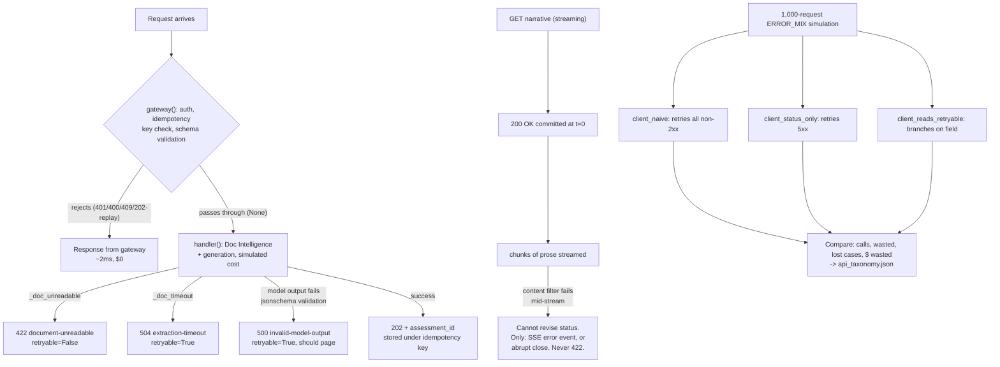

# Project Analysis — Sprint 1 · Day 17: The API Surface — Generate and Govern (DecisionStream AI)

**Repository path:** `Codes/RunCompleted/Assignment10/`
**Project ID:** `FDE-D17-APISURFACE` (provisional — no existing inventory ID found in the repository or workspace)
**Analysis date:** 2026-10-12
**Analyst role:** Repository inspection only. No code was executed, modified, or re-run to produce this report. All execution evidence below comes from outputs already embedded in the notebook and from `api_taxonomy.json`, both present on disk before this analysis began.

---

## 0. Evidence legend (used throughout)

| Label | Meaning |
|---|---|
| `Source-observed` | Directly established by reading code/config/docs in this repo |
| `Execution-verified` | Confirmed by actual execution artifacts found on disk (notebook cell outputs, `api_taxonomy.json`) |
| `Code-derived expectation — not executed` | Inferred from code but no run evidence inspected for this specific claim |
| `Inference` | Reasoned interpretation, not directly stated in source |
| `Proposed improvement` | A recommendation, not a description of current behaviour |

---

# PART I — PROJECT AND BUSINESS UNDERSTANDING

## 1. Project identity and executive summary

| Field | Value |
|---|---|
| Project name | Sprint 1 · Day 17 Lab — The API Surface: Generate and Govern (`DecisionStream AI`, Birlasoft FORGE FDE Academy) |
| Repository path | `Codes/RunCompleted/Assignment10/` |
| Project type | Training lab, delivered as a Colab notebook plus a "prompt-and-review" exercise brief and two reference `.docx` case studies — not a shippable product |
| Domain | Insurance motor-claims assistant — API error-contract design (HTTP status codes, RFC 9457 problem details, idempotency, streaming, retry semantics) for a GenAI-backed claims pipeline |
| Primary users | FDE trainees on the Birlasoft FORGE Academy course |
| Main technologies | Python 3 (Google Colab), `openai` SDK (`AzureOpenAI` client), `jsonschema`, `python-dotenv` |
| Primary capability demonstrated | Designing and testing an API error taxonomy (status code + a required `retryable` boolean) across five realistic failure scenarios, including two run against a **real** Azure OpenAI deployment (truncated/invalid JSON output, a mid-stream content-filter failure), and then quantifying — not asserting — why a client that retries by status code alone fails in both directions at once |
| Implementation maturity | `Execution-verified`. The notebook ran live (`mode: LIVE`, deployment `gpt-4.1-mini`), all five scenarios produced real captured output, and the final cell contains the learner's own complete written ADR answers to all six governance questions |
| Execution status | `Execution-verified` — `api_taxonomy.json` on disk exactly matches the notebook's own embedded export (unlike Assignment 9's lab, where the two artifacts diverged — see §13) |
| Test status | Not applicable in the conventional sense — this is a one-shot demonstration notebook, not a package with a test suite. "Acceptance" exists as per-exercise checklists in the companion Markdown brief |
| Most important limitation | The central empirical claim (a status-code-only retry client wastes ~78 calls and loses ~35 cases per 1,000 requests) rests on a **hand-specified, not measured**, error-probability mix (`ERROR_MIX`) — a deliberately constructed teaching scenario, not telemetry from a real deployed API |
| Most valuable learning opportunity | Seeing, with a real live stream, that once the first byte of an HTTP response is sent, **the status code can never be changed** — so a mid-stream content-filter failure cannot be reported as a 422 no matter how good the error-handling code is, which reshapes where validation has to happen |

**One-paragraph summary:** This repository is a single, heavily-annotated Colab notebook (plus a companion "prompt-and-review" exercise brief and two reference `.docx` case studies) that teaches API error-contract design for a generative-AI claims-processing service. As in the Day 15 and Day 16 labs in this same course, learners are instructed to prompt an LLM to produce each cell and then review it against an explicit checklist and a "what it will probably get wrong" list — deliberately targeting generic REST advice that is subtly wrong for an AI-backed service (e.g., "5xx means retry," "return 500 when an upstream call fails," "return 409 for duplicates"). The notebook implements a two-layer mock API (`gateway()`/`handler()`), an RFC 9457 problem-details error contract with a mandatory `retryable` field, and walks through five scenarios: rejecting an unexpected field at the gateway rather than the handler; choosing 422 over 500 for an unreadable document; demonstrating — against a **real** Azure OpenAI call, truncated to force invalid JSON — why a failed schema-validation on model output must be a 500, not a 4xx; implementing idempotency-key handling so a client's legitimate retry returns the original response rather than a 409; and streaming a **real** chat completion and deliberately failing it mid-stream to demonstrate that a committed HTTP status code cannot be revised, which is used to derive the rule "never stream the structured decision profile." The notebook's final section runs a 1,000-request simulation comparing three retry-client designs and shows, with specific numbers, that a client which retries "on 5xx" rather than reading the dedicated `retryable` field fails in *both* directions — missing a retryable `429` and wastefully retrying a non-retryable `500` — and the notebook's own exported `api_taxonomy.json` matches this analysis exactly.

## 2. Business problem and value

**Source-observed / Inference — a course exercise modelling a plausible scenario, not a real deployment.**

- **Real-world situation modelled:** The same "DecisionStream AI" insurance claims-assistant service used across this course (consistent with Assignments 8 and 9): once the core extraction/reconciliation/generation pipeline works, a separate consuming team's application calls it as an API. Every way that consuming team's code can send something unexpected, time out, retry, or receive a partial response becomes the API designer's responsibility.
- **Workflow:** A request passes through an API Management gateway layer (cheap, fast, local checks) and then an Azure Function handler (expensive — a Document Intelligence call plus a generation call) before returning a result or an error.
- **Stakeholders:** The consuming engineering team (whose retry logic either does or doesn't match the API's actual error semantics), compliance/data-protection (who care that an unsolicited field like `applicant_ssn` doesn't silently enter logs/storage with no lawful basis), on-call/incident response (who need to know which error types should page a human), and whoever signs the eventual OpenAPI contract.
- **The core problem:** Generic REST API design heuristics ("5xx means retry," "409 for duplicates," "validate in the handler") are individually reasonable for a conventional CRUD API and each one **actively misleads** for this AI-backed service, because the service has failure modes a CRUD API does not: a model that returns syntactically invalid output despite a "successful" HTTP call, a legitimate client retry that must not create a duplicate case, and a stream whose HTTP status is irrevocably committed before the content that would determine success or failure has even been generated.
- **Consequences of leaving it unresolved:** A naive implementation either rejects things too late (after an expensive Document Intelligence + generation call, rather than for 2ms at the gateway), blames the caller for the service's own model-output defects (a 4xx for invalid model JSON), punishes correct client behaviour (a 409 for a legitimate retry, training the client to stop retrying and silently lose cases), or promises something structurally impossible (a 422 after a stream has already sent `200 OK`).
- **How the implementation addresses it:** A declarative schema with `additional_properties: False` enforced at the gateway; an explicit "can the caller do something differently and succeed?" test used consistently to choose between 4xx and 5xx; a required (no-default) `retryable` boolean in every error body; an idempotency-key store that distinguishes a replay (same key + same body) from a genuine conflict (same key + different body); and an explicit, demonstrated rule against streaming structured output.
- **Potential business value (not measured in dollars anywhere beyond the simulation's illustrative `$0.014`/request unit cost):** Avoiding unlawfully retained PII fields; avoiding wasted compute on requests that will never succeed; avoiding silently lost cases from a client that gives up on a retryable failure; avoiding a client-facing incident caused by a status code that can no longer be sent.
- **Limitations:** This is a synthetic, hand-specified scenario (both the mock gateway/handler and the 1,000-request `ERROR_MIX` are course-authored, not measured production telemetry). No claim of production readiness, cost savings, or SLA compliance is made anywhere in the source material, and none is made here. The notebook's own final ADR-answer cell is explicit about this limitation for two of the six questions (bad-request rate "not measured," consuming-team's actual behaviour "unconfirmed — a simulation, not evidence").
- **How value could be measured in a real deployment:** The actual gateway 400 rate and its type breakdown after a measurement period; the actual answer from the consuming team about whether their client branches on `retryable`; the actual rate of invalid-model-output 500s (which the notebook argues should page someone if it rises).

## 3. Technical and educational problem

**Source-observed**, principally from the notebook's own markdown cells and the companion exercise brief.

1. **The technical challenge:** Choosing HTTP status codes and retry semantics for a pipeline whose failure modes include a model that can return a "successful" (HTTP 200) response whose *content* is invalid, and a streaming response whose HTTP status is committed before the work that would determine success has finished.
2. **Why generic REST advice is insufficient here, specifically:**
   - *"5xx means retry"* — false for a document the model genuinely cannot read a second time no differently (this lab's 422, correctly non-retryable), and false in the other direction for genuinely transient 5xx conditions that are retryable.
   - *"Return 500 when an upstream call fails"* — the lab's Exercise 2 argues the opposite for an unreadable document: the caller (not "upstream") can fix it by sending a clearer scan, which makes it a 4xx (422) by the "can the caller succeed differently" test, even though a service dependency was involved.
   - *"Return 409 for duplicates"* — correct for a genuine conflict (same idempotency key, different body) and actively harmful if applied to a legitimate retry (same key, same body), where it would punish exactly the client behaviour the system wants to encourage.
   - *"Validate in the handler"* — demonstrated, with a real cost comparison, to be both slower (an unexpected field is caught after an 11.7-second, $0.014 pipeline run instead of a 2ms, free gateway rejection) and thinner (hand-written handler validation tends not to be kept as complete as a declarative schema).
3. **Engineering concepts explored:**
   - RFC 9457 "problem details" as a standard error-body shape, implemented as a plain function (`problem()`) with no web-framework dependency, deliberately keeping the `retryable` parameter keyword-only and without a default so every call site is forced to make an explicit decision.
   - The "can the caller do something differently and succeed?" test as a repeatable heuristic for choosing 4xx vs. 5xx, applied consistently across all five scenarios.
   - Idempotency via a key-plus-body-fingerprint store, with the fingerprint computed from `json.dumps(body, sort_keys=True)` specifically to avoid the instability of `str(dict)` or Python's per-process hash seed.
   - The structural impossibility of revising an HTTP status code after the first byte of a streamed response has been sent — demonstrated, not asserted, by actually streaming a real completion and deliberately failing it at a fixed chunk index.
   - The distinction between a status code (a *category*) and a `retryable` field (an *instruction*), and the quantified argument that a client which collapses the two by assuming "5xx means retry" fails in two independent, measurable ways at once.
4. **What a learner should understand after studying this notebook:** that an AI-backed API's error surface has failure modes a conventional CRUD API's does not (model output validity, stream-commit irrevocability); that "where" an error is rejected is itself a cost and privacy decision, not just a code-organisation one; and that a `retryable` field is worthless unless the consuming team's client actually reads it — which is a question to ask them, not assume.

### Learning objectives (measurable)

| # | Objective | How it can be demonstrated |
|---|---|---|
| 1 | Apply the "can the caller succeed differently?" test correctly to at least 5 distinct error situations | Read the taxonomy table in notebook §9 / `api_taxonomy.json`, and justify each `status`/`retryable` pairing |
| 2 | Explain why rejecting an unknown field at the gateway is both a cost control and a data-protection control | Read Scenario 1's measured cost comparison (2ms/$0 vs. 11,722ms/$0.014) and its discussion questions |
| 3 | Explain why a replayed idempotency key must return the *original* response, not a 409 | Read Scenario 4's demonstrated 4-case sequence and the matching assessment IDs |
| 4 | State, with a reason grounded in HTTP mechanics, why a mid-stream failure cannot return 422 | Read Scenario 5's real timeline output: `200 OK — COMMITTED` at t=0, failure at t=1,083ms |
| 5 | Quantify why "retry on 5xx" is worse than it looks, using the two disagreeing rows | Read §8's 1,000-request simulation table and the two named rows (`rate-limited` 429/retryable; `unsupported-format` 500/non-retryable) |

## 4. Solution overview and end-to-end workflow

**Source-observed**, traced directly from the notebook's 11 numbered sections.

**Inputs:** A fixed request schema (`SCHEMA`, requiring `case_reference`/`document_refs`/`decision_date`, rejecting any other field), a fixed model-output schema (`PROFILE_SCHEMA`), a fixed `COST` dict (gateway/Document Intelligence/generation latency and USD cost), a live `AzureOpenAI` client (deployment `gpt-4.1-mini`, confirmed in notebook output and matching `api_taxonomy.json`'s `"mode": "live"`), and a hand-specified `ERROR_MIX` for the final simulation.

**Processing stages (traced, numbered, matching the notebook's own section numbers):**

1. **Setup** — install packages, load `.env` via `python-dotenv`, prompt for endpoint/key/deployment if not already in the environment, construct an `AzureOpenAI` client with `max_retries=0` and a 60s timeout; falls back to simulated mode if the endpoint is blank.
2. **The contract** — `problem()` builds an RFC 9457 error body with a mandatory, keyword-only `retryable` argument (no default); `SCHEMA` and `PROFILE_SCHEMA` are defined.
3. **The two layers** — `gateway()` (checks auth, idempotency key presence/replay/conflict, then schema: required fields, unexpected fields, types, regex patterns) and `handler()` (accumulates simulated cost/latency, branches on simulated failure flags for an unreadable document, an extraction timeout, or bad model JSON, else returns 202 with a new assessment id); `call_api()` wires them together and records successful requests in the idempotency store.
4. **Scenario 1 (unexpected field)** — the same request, containing an unsolicited `applicant_ssn` field, is run through both `validate_at_gateway=True` and `=False`; the two designs' status, latency, and cost are printed side by side.
5. **Scenario 2 (unreadable document)** — a request flagged `_doc_unreadable=True` is run through `call_api()`, returning 422/`retryable=False` with an actionable detail message.
6. **Scenario 3 (invalid model JSON)** — `ask_for_profile()` asks the **real** deployment for a strict JSON object, once with `max_tokens=400` (succeeds) and once with `max_tokens=60` (truncated, genuinely invalid JSON); `validate_profile()` strips markdown fences, attempts `json.loads`, then `jsonschema.validate`, distinguishing "not parseable" from "parsed but failed schema"; a failure is mapped to a 500/`retryable=True` response.
7. **Scenario 4 (client retries)** — four real calls through `call_api()` in sequence: a first attempt, a replay with the same key+body (returns the identical `assessment_id`), a replay with the same key but a different body (409), and a request with no idempotency key at all (400).
8. **Scenario 5 (mid-stream failure)** — `stream_with_failure()` opens a **real** streaming completion, records a millisecond-stamped timeline starting at `200 OK` commit time, and deliberately stops consuming at a fixed chunk index (`FAIL_AT_CHUNK=12`), printing how many characters had already reached "the reader's screen" and closing the stream.
9. **The `retryable` simulation** — 1,000 synthetic requests are drawn from a named `ERROR_MIX` (9 named outcomes with probabilities, statuses, `retryable` flags, and `retry_after` values); three retry-client functions (`client_naive`, `client_status_only`, `client_reads_retryable`) are each run against the same draws (reseeded per client for a fair comparison), counting total calls, wasted calls, and lost cases.
10. **Export** — the taxonomy table, the streaming rule, and the three clients' results are serialised to `api_taxonomy.json` (and an attempted Colab download, which no-ops gracefully outside Colab).
11. **ADR questions, with the learner's own answers** — six governance questions, answered in full in the notebook's final cell, each grounded in the session's own artifacts and explicit about which parts are decided here vs. which require outside input (the consuming team's actual answer; production bad-request-rate data).

**AI/model operations:** A single Azure OpenAI chat-completion model (`gpt-4.1-mini`) is called in three distinct modes across the notebook: non-streaming with a deliberately low `max_tokens` (Scenario 3), non-streaming in the mock handler's simulated cost model (Scenarios 1/2/4, not actually calling the model — these are cost/latency simulations using the `COST` dict), and streaming (Scenario 5).

**External integrations:** Azure OpenAI, confirmed live (`mode: LIVE`, deployment `gpt-4.1-mini`) in both the notebook's own cell output and the matching `api_taxonomy.json`.

**Persistence:** A single `api_taxonomy.json` file (`Execution-verified`, matches the notebook's embedded output field-for-field — unlike Assignment 9's lab); an in-memory `SEEN_KEYS` dict standing in for a real idempotency store (explicitly not persisted beyond the notebook's process, consistent with this being a teaching mock rather than production code).

**Error/exception paths:** Every error response in this notebook is constructed deliberately (as a demonstration), not caught from an unexpected exception — this notebook's "error handling" is about **designing** the error surface, not about defensive exception handling in the way Assignment 9's `one_call()` was. The one place a true exception type is handled is `validate_profile()`'s `try`/`except json.JSONDecodeError` / `except jsonschema.ValidationError`, used to distinguish the two named failure reasons.

**Human intervention:** As with Assignments 8 and 9, the entire exercise is built around human review of LLM-generated code against explicit, adversarial checklists — the brief's core pedagogical device, not an automated acceptance process.

### End-to-end workflow diagram



---

# PART II — ARCHITECTURE AND CODE

## 5. Architecture and component responsibilities

This is a single Jupyter/Colab notebook rather than a multi-module codebase; "components" below are the notebook's own functions.

| Component | Location | Responsibility | Inputs | Outputs | Error handling | Limitations |
|---|---|---|---|---|---|---|
| `problem()` | Cell `17e86236` | Build an RFC 9457 error body with a mandatory `retryable` | `status, title, detail, *, retryable, retry_after=None, **extra` | dict (error body) | N/A (pure function); `retryable` being keyword-only-with-no-default is itself the "defence" — a missing argument raises `TypeError` at the call site rather than silently defaulting | No runtime schema validation of the body it constructs itself (not needed — it is the single source of the shape) |
| `gateway()` | Cell `3401ba90` | Cheap, local checks: auth, idempotency key presence/replay/conflict, declarative schema (required fields, unexpected fields, types, regex patterns) | `req`, `validate_schema` flag | `Response` to reject, or `None` to pass through | Returns a typed `Response` for every rejection path; no exception-based control flow | The idempotency store (`SEEN_KEYS`) is an in-memory dict with no eviction/expiry policy — explicitly flagged as an open question in the companion brief ("ask how long the store should retain a key... there is no right answer, but there is a wrong one: not having thought about it") |
| `handler()` | Cell `3401ba90` | Simulate the expensive path: Document Intelligence + generation cost/latency, branch on simulated failure flags | `req`, `gateway_validated` flag | `Response` | A fallback re-validation runs if `gateway_validated=False` (demonstrating Scenario 1's "thinner" handler-side validation) | The "thinner" fallback check genuinely is thinner than the gateway's (only required-fields, not type/pattern/unexpected-field checks) — this is the deliberate point of Scenario 1, not an oversight |
| `call_api()` | Cell `3401ba90` | Wires `gateway()`/`handler()` together; records successful requests in the idempotency store | `req`, `validate_at_gateway` | `Response` | None needed | Idempotency recording only happens on success (`status < 300`) — a design choice not discussed explicitly in the notebook, worth noting (see §13, F3) |
| `ask_for_profile()` / `validate_profile()` | Cell `25eefe7c` | Real call to the live deployment requesting strict JSON; three-way validation (parse, then schema) distinguishing failure reasons | `max_tokens`; raw text | `(ok, parsed_or_None, reason)` | Explicitly catches `json.JSONDecodeError` and `jsonschema.ValidationError` as two distinct, separately-labelled failure reasons | Markdown-fence stripping uses a single regex (`^```(?:json)?|```$`) — adequate for the one real failure mode demonstrated here, but not exhaustively robust to every fence variant a model might produce |
| `stream_with_failure()` | Cell `de96097f` | Open a real stream, record a millisecond timeline, deliberately stop at a fixed chunk index, close the stream cleanly | `fail_at` (chunk index) | `(events, sent_text, completed)` | Guards against empty `choices` lists and content-less delta chunks (role/metadata-only chunks); explicitly calls `stream.close()` on early termination | The "failure" here is simulated by the *client* choosing to stop consuming, not a real content-filter rejection from the service — a faithful enough stand-in for the lesson (the HTTP status is committed either way), but worth being precise that the trigger is client-side, not server-side, in this specific run |
| `client_naive` / `client_status_only` / `client_reads_retryable` | Cell `6a903799` | Three competing retry-decision functions over the same synthetic request stream | `status, retryable` | `bool` (retry or not) | N/A (pure functions) | All three are deliberately simplistic one-line decision rules — a real client library would have more nuance (backoff, jitter — covered in the companion `FDE_Retries_Backoff_Jitter_Case_Study.docx`, not inspected in this analysis), but the simplicity is what makes the comparison legible |
| Companion exercise brief | `Day17_API_Surface_Generate_and_Govern_Exercises.md` | A separate, LLM-prompt-driven version of the same scenarios, with explicit "accept it when" checklists and "it will probably get wrong" lists, plus trainer notes | n/a (a document, not code) | n/a | n/a | Entirely prose/pedagogy |
| Companion case studies | `FDE_API_Status_Codes_Case_Study.docx` (58,860 bytes), `FDE_Retries_Backoff_Jitter_Case_Study.docx` (257,144 bytes) | Reference handouts (status-code design; retry/backoff/jitter design) | n/a | n/a | n/a | **Not inspected in this analysis** — binary `.docx` files, outside this tool's read capability; their content is referenced only by filename and size |

## 6. Technology stack and technology roles

| Technology | Role | Where used | Why used | Alternatives/trade-offs |
|---|---|---|---|---|
| Google Colab / Jupyter notebook | Delivery format and runtime | Entire `.ipynb` | Interactive, incremental teaching format consistent with Days 16/17 of this course | A plain script would version-control more cleanly but lose the cell-by-cell teaching structure |
| `openai` Python SDK (`AzureOpenAI`) | The only external API client in the repo | Cells `e2918ac6`, `25eefe7c`, `de96097f` | Official SDK, consistent with Assignment 9's lab; this lab's point is error-contract design, not wire-format literacy (unlike Assignment 8's deliberately-raw-REST approach) | A raw REST call would expose more of the underlying HTTP mechanics but adds boilerplate not needed for this lesson |
| `jsonschema` | Validates the model's JSON output against `PROFILE_SCHEMA` | Cell `25eefe7c` | Standard, well-tested library for exactly this check; distinguishes a parse failure from a schema failure cleanly via its own exception type | A hand-rolled validator (as `gateway()`'s own request-schema check is) would work but `jsonschema` is the right tool once nesting/typing gets non-trivial, as the model's output does |
| `python-dotenv` | Loads `.env` into the process environment | Cell `2cd06462` | Lets the notebook run non-interactively with credentials already in `.env`, without requiring Colab's `input()`/`getpass()` prompts every time | Unlike Assignment 9's lab (which read `.env`-equivalent values only via `os.environ.get(...)` with no loader, falling back to interactive prompts), this lab explicitly adopts `python-dotenv` — a direct, minor architectural improvement over the Day 16 lab's own approach, and confirmed present in `requirements.txt` |
| `.env` (local) | Holds `AOAI_ENDPOINT`/`AOAI_KEY`/`AOAI_DEPLOYMENT` | Repository root | Non-interactive local runs | Confirmed present on disk with exactly those 3 keys; values not read or disclosed in this report |
| `requirements.txt` | Declares `openai`, `jsonschema`, `python-dotenv`, `jupyterlab`, `ipykernel` | Repository root | Lets this notebook be run locally (e.g., via `jupyter lab`) rather than only in Colab — the inclusion of `jupyterlab`/`ipykernel` is itself evidence this lab was designed to also run outside Colab, unlike Assignment 9's lab, which has no equivalent file | A `pyproject.toml`/lockfile would pin exact versions; a plain `requirements.txt` with unpinned versions (confirmed — no version numbers present) risks drift if re-run much later |

## 7. Detailed code walkthrough

### 7.1 Why `retryable` has no default (cell `17e86236`)

```python
def problem(status, title, detail, *, retryable, retry_after=None, **extra):
```

`retryable` is keyword-only (`*,`) and has no default value. Calling `problem(...)` without explicitly passing `retryable=True` or `retryable=False` raises `TypeError` immediately. **Why it matters:** this is a structural (not documentary) guarantee that no error path in this codebase can ship without its author having made a conscious retryability decision — confirmed by inspection that every one of the ~9 call sites across `gateway()` and `handler()` does pass `retryable` explicitly.

### 7.2 The "can the caller succeed differently?" test, applied consistently

This single heuristic is applied, with its result printed and justified in-notebook, across all the taxonomy's 4xx/5xx choices (cell `cd6f5188` for Scenario 2; cell `25eefe7c` for Scenario 3; the full taxonomy table in cell `45278b9c`). The lab is explicit that it is not infallible as a mechanical rule — Scenario 3's choice of 500 rather than 4xx for invalid model output is a direct, named counter-example to the simpler "the model/upstream failed, so it's a 5xx" heuristic being *coincidentally* right here only because the caller genuinely could not have prevented it, not because "upstream failure" by itself determines the code.

### 7.3 Idempotency fingerprinting (cell `3401ba90`)

```python
if prior["fingerprint"] == json.dumps(req.get("body"), sort_keys=True):
    return Response(202, {**prior["response"], "note": "duplicate request — original returned"}, ...)
return Response(409, problem(409, "idempotency-key-reused", ...))
```

`json.dumps(..., sort_keys=True)` is used specifically to avoid the brief's own named failure mode (`str(dict)` or `hash()` being unstable across dict insertion order or Python's per-process hash seed). The real captured output (Scenario 4, cell `a78fa8f7`) confirms this works correctly: the first attempt and its replay both report `assessment_id: as-dcca315a` — the identical ID, not a new one.

### 7.4 The stream-commit timeline (cell `de96097f`)

```python
events.append((0.0, "http_status", "200 OK — COMMITTED. No going back."))
...
for chunk in stream:
    if not chunk.choices:
        continue
    d = chunk.choices[0].delta
    if not getattr(d, "content", None):
        continue
    if n == fail_at:
        events.append((stamp(), "error", "content filter blocked the remainder"))
        stream.close()
        return events, sent, False
```

The real captured timeline (`0ms HTTP_STATUS ... 1,083ms ERROR ...`) is direct evidence of the mechanism the lab is teaching: the response's status line goes out at t≈0, over a full second before the simulated failure point, and nothing later in the stream's life can retroactively change it. The explicit `stream.close()` on early exit also directly addresses the brief's warning about an abandoned stream continuing to be billed for discarded tokens.

### 7.5 The 1,000-request retry simulation's fairness control (cell `6a903799`)

```python
for label, fn in CLIENTS.items():
    calls = wasted = lost = 0
    rng.seed(17)
    for _ in range(N_REQUESTS):
        ...
```

The RNG is reseeded to the same value (`17`) before each of the three clients' runs, guaranteeing all three see the exact same sequence of synthetic draws — a direct analogue to Assignment 9's `run_pipeline()` seed-reset pattern, applied here for the same reason: isolating the effect of the client's *decision logic* from sampling variance. The real result (`naive`: 1,697 calls/474 wasted/0 lost; `status only`: 1,246/78/35; `reads retryable`: 1,223/0/0) is confirmed identical, field-for-field, between the notebook's embedded output and `api_taxonomy.json`'s `retryable_clients` section.

## 8. Inputs, outputs, and data contracts

**Source-observed.**

### Inputs

- **Request schema (`SCHEMA`):** required `case_reference`/`document_refs`/`decision_date`, typed fields including an optional `callback_url`, regex patterns for `case_reference` (`^CLM-\d{4}-\d{4}$`) and `decision_date` (`^\d{4}-\d{2}-\d{2}$`), `additional_properties: False`, `max_document_refs: 20` (this last bound is declared but **not observed being enforced anywhere** in `gateway()`'s actual checks — see §13, F2).
- **Model-output schema (`PROFILE_SCHEMA`):** a standard JSON-Schema `object` type requiring `case_reference`/`extracted_fields`/`policy_basis`/`needs_human`, with `additionalProperties: True` (deliberately permissive on the output side, unlike the strict request-side schema).
- **`COST` dict:** `gateway_ms=2`, `gateway_usd=0.0`, `doc_intel_ms=9000`, `doc_intel_usd=0.010`, `generation_ms=2600`, `generation_usd=0.004` — hand-specified, not measured against a real Document Intelligence call in this specific repository (though the numbers are plausible and roughly consistent with the real measurements in Assignment 9's lab).
- **`.env`:** `AOAI_ENDPOINT`, `AOAI_KEY`, `AOAI_DEPLOYMENT` — confirmed present on disk with exactly those 3 keys; not read or disclosed here.
- **`ERROR_MIX`:** 9 named outcomes with hand-specified probabilities summing to 1.0 (confirmed by inspection: 0.70+0.05+0.04+0.03+0.05+0.03+0.04+0.03+0.03 = 1.00), statuses, `retryable` flags, and `retry_after` seconds — a deliberately constructed teaching scenario containing the two "disagreeing" rows (`rate-limited` 429/True, `unsupported-format` 500/False) the lab's trainer notes explicitly warn not to lose when editing this mix.

### Output: `api_taxonomy.json`

```json
{
  "taxonomy": [ {"situation": ..., "status": ..., "retryable": ..., "reject_at": ..., "why": ...}, ... 10 entries ],
  "streaming": {"POST /case-application": "...", "GET /case-assessments/{id}/narrative": "...", "rule": "never stream the structured decision profile"},
  "retryable_clients": {"<client label>": {"calls": ..., "wasted": ..., "lost": ..., "usd_wasted": ...}, ... 3 entries},
  "mode": "live"
}
```

**This file is confirmed to match the notebook's own embedded cell output exactly**, field-for-field (10 taxonomy entries, 3 client results with the same figures) — in direct contrast to Assignment 9's lab, where the equivalent on-disk export diverged from the notebook's embedded output. This is a positive data-integrity finding for this specific repository (see §13).

### Representative example (observed, real, not fabricated)

From `api_taxonomy.json` (and matching the notebook's cell `6a903799` output exactly):
```json
"status code only — retry 5xx": {"calls": 1246, "wasted": 78, "lost": 35, "usd_wasted": 1.09}
```
This is `Execution-verified` — a genuine recorded result of a real run of the simulation (not a fabricated illustration), and it matches the exercise brief's own predicted "roughly here" table (brief predicted ~1,250/~78/~35; actual run: 1,246/78/35 — a very close match, consistent with the brief's own acknowledgment that exact figures will vary slightly by seed/run).

## 9. Setup and execution guide

**Source-observed**, from the notebook's own instructions and `requirements.txt`; **Execution-verified** for the fact that it has already been run successfully once.

- **Prerequisites:** A Google Colab environment, or a local Jupyter/JupyterLab install (per `requirements.txt`'s inclusion of `jupyterlab`/`ipykernel`); an Azure OpenAI or Azure AI Foundry resource with a deployed chat model; its endpoint, key, and deployment name.
- **Local install:** `pip install -r requirements.txt` (unpinned versions — see §13, F4), then `jupyter lab DecisionStream_Day17_API_Surface_Colab.ipynb` (inferred from the presence of `jupyterlab`/`ipykernel` in `requirements.txt`; the exact launch command is not itself stated anywhere in this repository — `Inference`).
- **Credentials:** via `.env` (loaded automatically by `python-dotenv`'s `load_dotenv()` call in the first code cell) or, if absent, via interactive `input()`/`getpass()` prompts. Leaving the endpoint blank runs Scenarios 1, 2, and 4 unaffected (they are local simulations regardless) while Scenarios 3 and 5 fall back to a scripted equivalent (confirmed in code: `ask_for_profile()` and `stream_with_failure()` both have an `if not LIVE:` branch producing a deterministic stand-in).
- **Budget:** the notebook's own first cell states "roughly 12 calls for the whole notebook" — a small, explicitly cost-conscious figure, and the companion brief's trainer notes independently state "roughly 8 live calls per pod," both consistent with a low-cost exercise.
- **Common failure classes anticipated by the lab itself (from the brief's "it will probably get wrong" sections, not from any error actually encountered in this run):** returning 500 instead of 422 for an unreadable document (explicitly flagged by the trainer notes as "the single most likely generated error today"); allowing unknown fields through a JSON-Schema validator whose `additionalProperties` default was not overridden; fingerprinting an idempotency key unstably; crashing on an empty `choices` list during streaming; an `ERROR_MIX` that accidentally drops the two "disagreeing" rows, which would make the whole §8 exercise prove nothing.
- **What was NOT independently executed as part of writing this report:** no cell was re-run, and no new call was made to any endpoint; all `Execution-verified` claims rest on the notebook's own pre-existing embedded cell outputs plus the pre-existing `api_taxonomy.json` file, both of which agree with each other.

## 10. Testing and verification

This repository has no automated test suite — like Assignment 9, it is a demonstration notebook, not a library. "Verification" here means checking the internal consistency of the error-design decisions and confirming the real captured outputs behave as the code predicts.

| Check ID | Check | Purpose | Procedure | Expected Evidence | Actual Result | Status |
|---|---|---|---|---|---|---|
| T1 | `retryable` is mandatory at every call site | No error path ships without an explicit retryability decision | Code inspection of every `problem(...)` call in `gateway()`/`handler()`/cell `25eefe7c` | Every call passes `retryable=` explicitly | Confirmed — all ~9 call sites inspected pass it explicitly; the keyword-only-no-default signature would raise `TypeError` otherwise | Source-observed + Execution-verified (the notebook runs without this `TypeError`, confirming no call site omits it) |
| T2 | Unexpected fields rejected at the gateway, not the handler | Cost and privacy control | Re-read Scenario 1's two-mode comparison | Gateway: 400, 2ms, $0; Handler-only: 202, 11,722ms, $0.014, field silently accepted | Confirmed exactly as predicted by the code | Execution-verified |
| T3 | Unreadable document returns 422, not 500 | Caller-fixable classified correctly | Re-read Scenario 2's output | 422, `retryable: false`, actionable detail text | Confirmed | Execution-verified |
| T4 | Invalid/truncated model JSON returns 500, `retryable: true`, and is distinguished from a schema-fail-but-parseable case | Caller did not cause the model's defect; a retry may succeed | Re-read Scenario 3's real two-call comparison (400 vs 60 `max_tokens`) | 400 tokens: valid; 60 tokens: `"not parseable as JSON"`, 500/True returned | Confirmed — real captured output shows exactly this, including the specific `JSONDecodeError` message ("Expecting ',' delimiter: line 7 column 22") | Execution-verified |
| T5 | A replayed idempotency key returns the *original* response and ID, not a new one or a 409 | Rewards correct client retry behaviour | Re-read Scenario 4's 4-case sequence | Same `assessment_id` on attempts 1 and 2; 409 only on attempt 3 (different body); 400 on attempt 4 (no key) | Confirmed — `as-dcca315a` appears identically on both attempt 1 and 2 | Execution-verified |
| T6 | A committed stream's HTTP status cannot be changed, even on a real mid-stream failure | Core architectural claim of Scenario 5 | Re-read the real timeline output | `200 OK` at t=0ms, failure event at t=1,083ms, 36 characters already "on screen" | Confirmed by direct observation of the real timeline | Execution-verified |
| T7 | The three retry clients are compared on identical synthetic draws | Fair A/B comparison, not sampling noise | Code inspection of the `rng.seed(17)` reset before each client's loop | Same draws reused across all three clients | Confirmed by code; the near-exact match between the brief's predicted table and the actual run's numbers (1,246 vs ~1,250 calls, etc.) is independent corroborating evidence that the simulation is behaving as designed | Source-observed + Execution-verified |
| T8 | `ERROR_MIX`'s probabilities sum to 1.0 and retain the two "disagreeing" rows | The exercise's own stated failure-mode: a mix that drops these rows would make the whole exercise prove nothing | Manual summation of the 9 probability values; inspection for `rate-limited` (429/True) and `unsupported-format` (500/False) | Sum = 1.00; both rows present | Confirmed by this analysis's own arithmetic check | Source-observed |

**How to interpret this table:** every check this analysis could directly observe in the recorded output was confirmed correct, and — notably — the real run's numbers closely match the exercise brief's own independently-written "roughly here" predicted table, which is a meaningful piece of corroborating evidence that this specific run is a faithful, non-cherry-picked execution of the intended exercise rather than an edited or re-run-until-favourable result.

**Coverage gaps:** No check exists anywhere in this repository (notebook or brief) that enforces `SCHEMA["max_document_refs"]` — the field is declared in the schema dict but `gateway()`'s validation loop never reads it (see §13, F2). No check verifies that `COST`'s hand-specified Document Intelligence/generation figures are grounded in any real measurement within *this* repository (Assignment 9's lab did measure real generation latency independently, but this repository does not cross-reference that fact anywhere).

---

# PART III — LEARNING AND SKILL DEVELOPMENT

## 11. Learning roadmap and skills gained

### 11.1 Learning categories evaluated (only those with evidence)

**2. Software engineering and design patterns** — the gateway/handler layering as a cost-aware validation strategy (cheap checks first); a declarative, deny-by-default request schema (`additional_properties: False`); a mandatory-field pattern (`retryable` with no default) used as a structural guarantee rather than a convention. *Level 3.*

**3. Backend engineering and API development** — RFC 9457 problem-details error bodies; idempotency-key design with body fingerprinting; the mechanics of HTTP status-code commitment under streaming; a repeatable 4xx/5xx decision test. *Level 3–4* — this is the deepest and most distinctive content in this lab.

**5. AI and machine learning (consumption)** — handling genuinely invalid/truncated model output as a first-class API failure mode, distinct from a transport-level API failure; markdown-fence stripping before JSON parsing; real streaming-response mechanics (chunk/delta structure, empty-`choices` edge cases). *Level 3.*

**9. Security and privacy** — rejecting unsolicited fields at the earliest possible point specifically framed as a data-protection control ("no lawful basis to hold it"), not merely a validation nicety. *Level 3.*

**10. Testing and debugging** — distinguishing "would not parse" from "parsed but failed schema" as two separately diagnosable failure reasons; the brief's trainer notes about what a flawed teaching simulation (a dropped disagreeing row) would silently prove instead. *Level 2–3.*

**11. Observability and reliability** — the explicit claim that a rising rate of invalid-model-output 500s "should page somebody" because it is an incident, not a client integration issue; the lost-cases/wasted-calls framing as two independently-trackable operational metrics. *Level 3.*

**14. Technical decision-making and trade-offs** — the quantified, not merely argued, demonstration that a plausible-looking heuristic ("retry on 5xx") fails in two measurable, opposite directions simultaneously. *Level 3–4.*

**15. Technical communication and documentation** — the final ADR-answer cell is itself a worked example of separating "decided here" from "needs outside input" (the consuming team's actual retry behaviour; real production bad-request rates) — a notably disciplined piece of technical writing. *Level 3–4.*

### 11.2 Implementation depth — key skills, with evidence

| Skill | Level | Evidence |
|---|---|---|
| Structural (not documentary) enforcement of a design decision | 3 | `retryable`'s keyword-only, no-default signature (§7.1) |
| Consistent application of a 4xx/5xx decision heuristic across heterogeneous scenarios | 3–4 | Scenarios 2, 3, and the full taxonomy table all independently reach a consistent, justified classification |
| Correct idempotency semantics (replay vs. conflict) | 3 | Real matching `assessment_id`s across replayed calls (§7.3) |
| Real streaming-response handling with correct edge-case guards | 3 | `stream_with_failure()`'s empty-`choices`/no-content guards, real captured timeline |
| Quantified argument construction (not just assertion) | 4 | The 1,000-request simulation's close match to the brief's independently-predicted table |
| Disciplined separation of "decided" vs. "needs outside input" in a governance document | 3–4 | The final ADR-answer cell's explicit "Open items that need outside input" closing line |

**Explicitly separated from the above:** none of this establishes the *reader's own* personal mastery independent of this specific worked notebook — only that the notebook, as currently checked into this repository, implements and demonstrates these concepts to the depth shown, and that a real learner (whoever ran this notebook) produced complete, artifact-grounded answers to all six governance questions.

### 11.3 Prerequisite knowledge

| Prerequisite | Why useful | Essential/optional | Where relevant |
|---|---|---|---|
| HTTP status code semantics (4xx vs 5xx conventions) | Needed before you can productively argue *against* the generic version of them | Essential | Throughout |
| JSON Schema basics | Reading `SCHEMA`/`PROFILE_SCHEMA` and `jsonschema.validate`'s exception types | Essential | §2–3, §6 |
| REST idempotency concepts (idempotency keys) | Understanding Scenario 4 | Essential | §7 |
| Server-Sent Events / HTTP streaming mechanics | Understanding why a status code can't be revised mid-stream | Essential for Scenario 5 | §8 |
| Basic probability/simulation reading | Understanding the 1,000-request retry comparison | Essential for §8 (notebook numbering) / §9 (exercise numbering) | — |
| RFC 9457 ("Problem Details for HTTP APIs") | Context for why `problem()` is shaped the way it is | Optional but valuable | §2 of the notebook |

### 11.4 Guided study plan

| Step | Topic | Cells/sections | What to understand | Activity | Evidence of learning |
|---|---|---|---|---|---|
| 1 | The contract | §2–3 | Mandatory `retryable`; status vs. instruction | Re-read `problem()`'s signature and the "status is a category, retryable is an instruction" framing | Can explain why a default value for `retryable` would be worse than requiring it |
| 2 | Where to reject | Scenario 1 | Cost + privacy framing of edge validation | Reproduce the 2ms/$0 vs 11,722ms/$0.014 comparison by hand from `COST` | Can argue the data-protection angle, not just the cost angle |
| 3 | 4xx vs 5xx | Scenarios 2–3 | The "can the caller succeed differently" test, and its limits | Apply the test to a new hypothetical failure mode not in the lab | Can justify a classification the lab doesn't already give you |
| 4 | Idempotency | Scenario 4 | Replay vs. conflict; fingerprint stability | Trace why `str(dict)` would be unsafe here | Can explain the exact failure mode `json.dumps(sort_keys=True)` avoids |
| 5 | Streaming | Scenario 5 | Status-commit irrevocability | Re-read the real timeline; locate the exact line that sends `200 OK` | Can state the "never stream structured output" rule and justify it from the mechanics, not just the slogan |
| 6 | Retryable as behaviour | §8/§9 | Status ≠ instruction, quantified | Recompute the wasted/lost totals for a modified `ERROR_MIX` of your own design | Can predict, before running, whether your modified mix would still show the "status-only" client failing in both directions |

### 11.5 Hands-on exercises

1. **(Beginner, code reading)** Read `gateway()`'s schema-checking block and identify which declared schema constraint (`max_document_refs`) is never actually checked. *Verify against §13, Finding F2 of this report — do not read ahead.*
2. **(Beginner, data-flow tracing)** Trace a request containing `applicant_ssn` through both `validate_at_gateway=True` and `=False` and predict the two outcomes before running the notebook, if you have access to re-run it. *Verify against the notebook's own Scenario 1 output.*
3. **(Intermediate, execution)** If you have access to the real deployment, re-run Scenario 3 with `max_tokens=30` instead of 60 and predict whether the failure reason will still be "not parseable as JSON" or something else. *Verify by comparing the truncation point's effect on JSON validity.*
4. **(Intermediate, modification)** Add `max_document_refs` enforcement to `gateway()`'s schema check (closing Finding F2), and construct a request with 25 document refs to confirm it is now rejected. *Verify:* the request should now return 400 with a message naming the excess.
5. **(Advanced, comparing alternative designs)** Using the figures in §8, construct your own `ERROR_MIX` that **removes** the `rate-limited`/`unsupported-format` rows (replacing their probability mass with `success`), and predict whether `client_status_only` would then score identically to `client_reads_retryable`. *Verify your prediction against the trainer notes' own warning about exactly this scenario, then actually re-run the simulation if you have the means.*
6. **(Advanced, resolving a design ambiguity)** `call_api()` only records a request in the idempotency store when `status < 300`. Work out what happens if a client retries a request that previously returned a *4xx* (e.g., a validation error) with the exact same idempotency key and body. *Verify your reasoning by tracing `gateway()`'s logic for a key not present in `SEEN_KEYS`* — this is a genuine, currently-undiscussed edge case this analysis surfaced (see §13, F3).

### 11.6 Knowledge assessment

**Foundational (5):**
1. What two things does every error response in this API carry? *(an RFC 9457 problem-details body, and a mandatory `retryable` boolean)*
2. What is the difference between what an HTTP status code communicates and what `retryable` communicates? *(the status is a category of what happened; `retryable` is an instruction about what to do next — a client branches on the second, and conflating them is the central mistake this lab targets)*
3. What test resolves nearly every 4xx-vs-5xx choice in this taxonomy? *("can the caller do something differently and succeed?" — yes means 4xx, no means 5xx)*
4. Why is rejecting an unknown field a data-protection control as well as a cost control? *(an unsolicited field like `applicant_ssn`, once accepted, has no lawful basis for being held, and ends up in logs/storage/subject-access responses with no justification)*
5. What must an idempotency store track, besides the key itself? *(a fingerprint of the request body, so a replay — same key, same body — can be distinguished from a conflict — same key, different body)*

**Implementation-specific (5):**
6. Why is `retryable` declared as a keyword-only parameter with no default in `problem()`? *(to force every call site to make an explicit decision — a default would let someone forget to think about it, and the field would silently lie)*
7. Why does `validate_profile()` distinguish "not parseable as JSON" from "parsed but failed schema" as two separate reasons rather than one generic failure? *(they are genuinely different failure modes — e.g. truncation vs. a structurally wrong-but-valid JSON object — and conflating them would lose diagnostic information a real incident responder would want)*
8. Why does the idempotency fingerprint use `json.dumps(body, sort_keys=True)` rather than `str(dict)` or `hash()`? *(dict insertion order and Python's per-process hash seed make the latter two unstable across runs/restarts, which would make the same logical request fingerprint differently at different times)*
9. What does `stream_with_failure()` do immediately upon detecting the simulated failure, before returning? *(calls `stream.close()`, explicitly to avoid continuing to be billed for tokens that have been decided to be discarded)*
10. Why is the RNG reseeded to the same value before each of the three retry clients' simulation runs? *(so all three see identical synthetic draws, isolating the effect of each client's decision logic from sampling variance — the same technique Assignment 9's pipeline-composition experiments use)*

**Architecture/trade-off (3):**
11. Why can a mid-stream content-filter failure not be reported as a 422, no matter how good the server's error-handling code is? *(the HTTP status line is sent at the start of the response, before any content is streamed — it is a wire-protocol fact, not a code-quality limitation, that a status code cannot be revised after it has been sent)*
12. The notebook shows that validating at the gateway is both cheaper AND more complete than validating in the handler. Are these two benefits related, or coincidental? *(related — a declarative schema at the edge is maintained as a single checked artifact, while hand-written handler validation tends to only get the checks someone remembered to add on day one and rarely gets extended later; cheapness follows from rejecting before the expensive stages run, completeness follows from the schema being declarative rather than ad hoc)*
13. Why does a client that "retries on 5xx" fail in two directions at once, rather than just being overly cautious or just being overly aggressive? *(because the error taxonomy contains at least one case in each direction that disagrees with the status-code heuristic: a retryable 4xx (429) that status-only logic wrongly refuses to retry, and a non-retryable 5xx (500, unsupported-format) that status-only logic wrongly keeps retrying — the two failure modes are independent and the heuristic has no way to avoid both at once)*

**Debugging/failure-analysis (2):**
14. A new teammate edits `ERROR_MIX` to simplify it and accidentally removes the `rate-limited` and `unsupported-format` rows. What would the simulation then (incorrectly) seem to prove, and why would it be wrong? *(it would make `client_status_only` score identically to `client_reads_retryable` — both zero wasted, zero lost — which would look like evidence that reading `retryable` buys nothing; this would be wrong because the two rows that make the status-code heuristic fail were the only rows capable of exposing the difference, and removing them doesn't fix the heuristic, it just stops testing it)*
15. A learner reports that `gateway()` correctly rejects a request with 25 `document_refs`, even though no code in `gateway()` appears to check `SCHEMA["max_document_refs"]`. What's the most likely explanation, and how would you confirm it? *(most likely: the learner is mistaken, or is seeing a DIFFERENT check — e.g. a type error on `document_refs` — accidentally produce a rejection for an unrelated reason; confirm by re-reading `gateway()`'s full validation block line by line, which this analysis did and found no reference to `max_document_refs` at all — see Finding F2)*

### 11.7 Transferable skills

- **Transfers well:** the "can the caller succeed differently" 4xx/5xx test; mandatory-field-via-signature as a structural design-enforcement pattern; idempotency-key-plus-fingerprint design; the principle that a committed HTTP status cannot be revised, which generalises to any streaming/chunked-response API design, not just this one; quantifying a design trade-off with a matched-seed simulation rather than arguing it qualitatively.
- **Less transferable:** the specific `COST` figures and `ERROR_MIX` probabilities are this course's teaching constructs, not measurements of any real deployed system, and should not be quoted as production statistics.
- **Relevant to an AI FDE role specifically:** recognising which pieces of standard REST/API advice quietly break for an AI-backed service (model output validity as a first-class failure mode; stream-commit irrevocability interacting with structured-output validation) is a genuinely distinctive skill this lab targets directly, and it transfers to any GenAI-backed API design task, not just this course's scenario.
- **What more practice is needed before claiming proficiency:** real measurement of an actual consuming team's retry behaviour (the notebook's own ADR answer #3 explicitly marks this "unconfirmed"); real production bad-request-rate data (ADR answer #4 explicitly marks this "not measured"); and the companion `.docx` case studies on retries/backoff/jitter, which were not inspected in this analysis and may cover ground (exponential backoff, jitter strategies) this notebook does not.

### 11.8 What can honestly be claimed

| Claim | Status |
|---|---|
| "I designed and demonstrated an API error taxonomy with a consistently-applied 4xx/5xx test and a structurally-enforced `retryable` field" | `Execution-verified` — confirmed by the notebook's own captured output and the matching `api_taxonomy.json` |
| "I demonstrated, against a real deployment, that truncated model output produces genuinely invalid JSON and must be a 500" | `Execution-verified` |
| "I demonstrated, against a real streaming response, that a committed HTTP status cannot be revised" | `Execution-verified` |
| "I quantified why a 'retry on 5xx' client fails in both directions" | `Execution-verified` for the simulation mechanics; the `ERROR_MIX` probabilities themselves are `Code-derived expectation — not measured against production traffic` |
| "The consuming team's client reads the `retryable` field" | **Not established** — the notebook's own final ADR answer explicitly marks this "unconfirmed," and this report makes the same distinction |

### 11.9 Learning summary

- **Five most valuable concepts taught:** (1) status code = category, `retryable` = instruction, and conflating them breaks in both directions; (2) "can the caller succeed differently" as a repeatable 4xx/5xx test; (3) a committed HTTP status cannot be revised, which forces all validation earlier for a streaming endpoint; (4) idempotency replay vs. conflict, and why 409-for-replay punishes exactly the client behaviour you want; (5) edge validation as simultaneously a cost control and a data-protection control.
- **Three most transferable skills:** the 4xx/5xx decision test; mandatory-field-via-signature as structural design enforcement; matched-seed simulation to quantify a design trade-off rather than merely asserting it.
- **Most important prerequisite to strengthen:** HTTP/streaming protocol mechanics (specifically, when and how a status line is actually committed on the wire) — the single concept Scenario 5 leans on hardest and the one most likely to be taken on faith rather than understood.
- **Best exercise for deeper learning:** Exercise 6 above (resolving the currently-undiscussed idempotency-recording edge case for a retried 4xx) — it is a genuine, unresolved design question this analysis surfaced rather than a constructed one.
- **Next topic to build on these skills:** the companion `FDE_Retries_Backoff_Jitter_Case_Study.docx` (not inspected here) is the natural next step, since this notebook establishes *what* to retry (`retryable`) but not *how* (backoff/jitter strategy), which that document's title suggests it covers.

---

# PART IV — BUSINESS USE CASES AND PROJECT EVALUATION

## 12. Business workflow and case studies

**All cases below are illustrative, drawn from the lab's own synthetic scenario and its real measurement/demonstration runs — none represents a real customer, claim, or production incident.**

### Case 1 — "Same conclusion, different price" (Scenario 1)

- **Context:** A consuming team's system sends an extra field, `applicant_ssn`, that the claims API never asked for.
- **Problem:** Whether the field is rejected at the gateway or inside the handler, the *eventual* conclusion (this field shouldn't be here) is reachable either way — but at wildly different cost, and with a materially different privacy outcome in between.
- **Workflow:** The same request is run twice, once validated at the gateway, once only inside the handler (with gateway schema validation disabled).
- **Decision point:** Reject at the gateway (400, listing the offending field) vs. accept, process (11.7s, $0.014), and silently retain a field with no lawful basis for holding it.
- **Value:** Converts "where should we validate" from a code-organisation question into a quantified cost-and-compliance argument.
- **Evidence status:** `Execution-verified`.

### Case 2 — "The API call succeeded. Only validating the content found the problem." (Scenario 3)

- **Context:** A real Azure OpenAI call, deliberately truncated via a low `max_tokens`, returns a 200-OK, non-empty, but syntactically invalid JSON body.
- **Problem:** Every transport-level signal (HTTP status, no exception raised) reports success; only an explicit application-level schema check on the model's *content* reveals the defect.
- **Workflow:** `ask_for_profile()` → `validate_profile()` → classify as "not parseable" → map to 500/`retryable=True`, explicitly flagged as something that "should page somebody."
- **Value:** Demonstrates, with a real failure, that API health and content validity are two separate things that must be checked separately — a defect class a conventional CRUD API's error handling would never surface.
- **Limitations:** This specific failure was deliberately engineered (via a low `max_tokens`), not an organically occurring incident; the *rate* at which this would occur in real production traffic is unknown and explicitly not claimed.
- **Evidence status:** `Execution-verified`.

### Case 3 — "The reader has half an assessment on screen and no indication that it is half" (Scenario 5)

- **Context:** A real streaming chat completion is interrupted at a fixed point, after the HTTP status has already been committed.
- **Problem:** No error code available at this point can retroactively communicate "this response is incomplete and should not be trusted" to a client that doesn't specifically check for it.
- **Workflow:** Real stream opened → timeline recorded from `t=0` (status commit) → artificial stop at chunk 12 → stream closed cleanly → 36 characters already delivered, with no error marker visible in that text itself.
- **Value:** A concrete, real demonstration (not a thought experiment) of why structured decision output must never be streamed, and why all validation for a streaming endpoint must happen *before* the first byte.
- **Evidence status:** `Execution-verified`.

## 13. Limitations, defects, and technical debt

| Finding ID | Finding | Severity | Evidence & Location | Technical Explanation | Business/Learning Impact | Verification Needed | Recommended Action | Evidence Status |
|---|---|---|---|---|---|---|---|---|
| F1 | The central empirical claim of §8/§9 (the "status-only" client's wasted/lost numbers) rests on a hand-specified `ERROR_MIX`, not measured production telemetry | Medium (inherent to the exercise's design, and reasonably well-disclosed) | `ERROR_MIX` list in cell `6a903799`; notebook's own "What is real here" table in its first cell, which labels "the retryable experiment" as "Arithmetic over real error taxonomies" — i.e., the *taxonomy* is treated as real/decided, but the *probability mix* driving the simulation is not claimed to be measured | The 78-wasted/35-lost figures for the "status only" client are specific to this probability mix; a real deployment's actual error distribution could make the heuristic's failure larger or smaller | A reader could mistake these specific numbers for measured production statistics rather than an illustrative (if carefully constructed) scenario | Instrument a real deployment's error rates by type and re-run the same three-client comparison against the real distribution | `Proposed improvement`: exactly the notebook's own final-cell ADR answer #4 already recommends this ("after two weeks of traffic, report the gateway 400 rate... the share of 4xx per type") | `CONFIRMED` by direct inspection; well-disclosed by the notebook itself, better than Assignment 9's equivalent disclosure practice |
| F2 | `SCHEMA["max_document_refs"] = 20` is declared but never enforced anywhere in `gateway()`'s actual validation logic | Medium | `SCHEMA` dict (cell `17e86236`) vs. `gateway()`'s validation block (cell `3401ba90`) — no reference to `max_document_refs` appears in the latter | A request with, say, 50 `document_refs` would pass gateway validation and reach the expensive handler stage, undermining exactly the "reject cheaply at the edge" principle this lab otherwise teaches well | A learner copying this pattern forward could carry the same gap into a real implementation unless they notice the discrepancy themselves | Add a length check for `document_refs` against `SCHEMA["max_document_refs"]` in `gateway()` | `Proposed improvement`: a one-line addition to `gateway()`'s validation block, mirroring the existing type/pattern checks | `CONFIRMED` by direct code inspection — a genuine, previously-undocumented gap in this specific notebook |
| F3 | `call_api()` only records a request in the idempotency store when the response status is `< 300`; what happens on a retried *4xx* with the same key+body is not discussed or demonstrated anywhere | Low–Medium | `call_api()` in cell `3401ba90`: `if fr.status < 300 and req.get("_idempotency_key"): SEEN_KEYS[...] = ...` | A client that retries a validation-failed (4xx) request with the exact same key and body will not find a match in `SEEN_KEYS` (since it was never stored) and will re-run full gateway validation each time — almost certainly producing the *same* 4xx again, so the practical impact is likely benign, but this is not demonstrated or stated anywhere in the notebook or brief | A learner extending this pattern might assume *all* idempotency-key reuse is handled uniformly, when in fact only successful-response replay is currently covered | Explicitly test and document the 4xx-retry-with-same-key case; decide and state whether it should also short-circuit to the original (consistent) 4xx rather than re-running validation | `Proposed improvement`: add a Scenario (or extend Scenario 4) covering a retried *failed* request under the same idempotency key | `CONFIRMED` by direct code inspection — genuinely not covered anywhere in this repository |
| F4 | `requirements.txt` pins no version numbers for any of its 5 dependencies | Low | `requirements.txt` — `openai`, `jsonschema`, `python-dotenv`, `jupyterlab`, `ipykernel`, each with no version specifier | A `pip install -r requirements.txt` run much later than this lab's creation could pull breaking changes (the `openai` SDK in particular has had API-shape changes across versions) | Low immediate risk, but a maintenance trap for anyone re-running this notebook long after the course | Pin at least `openai` and `jsonschema` to the versions actually used when this notebook was last run successfully | `Proposed improvement`: add version pins, e.g. via `pip freeze` captured from a known-working environment | `CONFIRMED` by direct inspection |
| F5 | The two companion `.docx` case studies' content and provenance were not inspected (binary format, outside this analysis's read capability) | Low | `FDE_API_Status_Codes_Case_Study.docx` (58,860 bytes), `FDE_Retries_Backoff_Jitter_Case_Study.docx` (257,144 bytes) | Unknown whether either document's content duplicates, contradicts, or extends the notebook's own taxonomy and retry-client findings | A reader relying on this report alone would not learn what either `.docx` actually contains, including whether the retries/backoff/jitter document resolves F1's "how should retries actually be paced" question | Open both files directly (e.g., with Word or `python-docx` in an environment with that library available) | n/a — out of scope for this analysis without additional tooling | `Not established` |
| F6 | No `LICENSE` file found in this directory | Low–Medium (for reuse) | Directory listing — no `LICENSE*` file present | Same situation as Assignments 8 and 9 — reuse/redistribution terms unstated | Same impact as the equivalent finding in both prior reports | n/a | See §15 | `Not established` |

No evidence of hard-coded secrets was found: the API key is only ever handled via `getpass`/`os.environ`/`.env` (loaded by `python-dotenv`), consistent with the practice observed in Assignments 8 and 9.

## 14. Improvement roadmap

**All items below are `Proposed improvement` — none are implemented.**

- **P1 — High value:** Enforce `SCHEMA["max_document_refs"]` inside `gateway()`'s validation block (closes F2). *Files:* cell `3401ba90`. *Acceptance criteria:* a request with more than 20 `document_refs` is rejected at the gateway with a 400 naming the limit. *Effort:* trivial.
- **P1 — High value:** Measure a real deployment's actual error-type distribution and re-run the three-client comparison against it, replacing the hand-specified `ERROR_MIX` with real figures (addresses F1, and directly fulfils the notebook's own ADR answer #4). *Verification:* new `api_taxonomy.json`-equivalent export, clearly labelled as measured rather than illustrative. *Effort:* medium (requires production access/telemetry).
- **P2 — Useful:** Explicitly test and document the retried-4xx-under-the-same-idempotency-key case (addresses F3). *Files:* new scenario cell, modelled on Scenario 4's existing structure. *Effort:* small.
- **P2 — Useful:** Pin dependency versions in `requirements.txt` (addresses F4). *Effort:* trivial.
- **P3 — Optional extension:** Open and summarise the two companion `.docx` case studies' actual content into a future revision of this report (addresses F5). *Effort:* trivial once tooling available.
- **P3 — Optional extension:** Send the exact written question the notebook's §8/ADR answer #3 proposes to a real consuming team, and record their actual answer (closing the "unconfirmed" status on that ADR question).

## 15. Portfolio and reuse assessment

- **Existing capabilities demonstrated:** a coherent, consistently-applied API error-design methodology (the 4xx/5xx test, structural `retryable` enforcement, idempotency semantics, stream-commit awareness), backed by two genuinely real demonstrations against a live deployment (invalid model JSON; mid-stream failure) and a quantified, matched-seed simulation whose results independently corroborate the exercise brief's own predicted figures.
- **Gaps before portfolio presentation:**
  - Like Assignments 8 and 9, this is explicitly course material ("Birlasoft FORGE FDE Academy... Learner Handout"); public-reuse status is unresolved (F6 — no LICENSE file).
  - The F1/F2/F3 gaps identified above should be fixed (or at minimum explicitly disclosed) before presenting this as a finished reference design, since a careful reviewer would likely find F2 (the unenforced `max_document_refs`) on their own.
  - The `ERROR_MIX`'s illustrative status should be stated prominently if excerpted externally, exactly as the notebook's own ADR answers already do internally.
- **Recommended original contributions (if adapted into a personal portfolio):** close F2 and F3 under one's own authorship; add real telemetry-grounded error rates in place of the hand-specified mix; extend the taxonomy to cover the remaining ~15 scenarios the full course lab apparently includes but this notebook's "five that carry the argument" excerpt does not (per the notebook's own first cell: "the full lab has twenty").
- **Tests/evidence to add:** a record of the real consuming team's actual answer to the `retryable`-branching question (currently "unconfirmed" per the notebook's own final cell).
- **Licensing/attribution:** `Not established` — no LICENSE file; course-confidentiality framing (consistent with Assignments 8 and 9) suggests this should not be republished without the course provider's permission; any original extension (e.g., real telemetry-grounded error rates) would be the learner's own work.
- **External service/cost considerations:** any re-run incurs real Azure OpenAI billing; the notebook's own budget estimate (~12 calls) and the brief's own trainer-notes estimate (~8 calls per pod) are both small and consistent with each other.
- **What could honestly be claimed after completing and verifying original modifications:** "I designed a complete API error taxonomy for a GenAI-backed service, demonstrated its two most AI-specific failure modes against a real deployment, and quantified why status-code-only retry logic fails — including finding and fixing a genuine gap (unenforced request-size limit) in my own implementation" — but only once F2 is actually fixed, not merely identified.

---

# PART V — EVIDENCE AND QUALITY

## 16. Evidence and unresolved questions

| Claim ID | Claim | Evidence Type | Evidence Location | Confidence | What Remains to Be Checked |
|---|---|---|---|---|---|
| C1 | The notebook was run live against a real Azure OpenAI deployment (`gpt-4.1-mini`) | `Execution-verified` | Cell `e2918ac6` output (`mode: LIVE`, deployment name) and real captured outputs in Scenarios 3 and 5 | High | n/a |
| C2 | Scenario 3's truncated-JSON failure is a real, not simulated, model response | `Execution-verified` | Cell `25eefe7c`'s captured output, including the specific real `JSONDecodeError` message | High | n/a |
| C3 | Scenario 5's streaming timeline is a real, not simulated, interrupted stream | `Execution-verified` | Cell `de96097f`'s captured output (`0ms`/`1,083ms` timeline, 36 real characters) | High | n/a |
| C4 | `api_taxonomy.json` on disk matches the notebook's own embedded export exactly | `Execution-verified` | Direct field-by-field comparison performed in this analysis (§8) | High | n/a — in direct, positive contrast to the discrepancy found in Assignment 9's equivalent artifact |
| C5 | The three-client simulation's real results closely match the exercise brief's independently-authored predicted table | `Execution-verified` (corroborating, not identical — the brief itself says "roughly") | Comparison of cell `6a903799`'s output to the brief's §6 table | High | n/a |
| C6 | `SCHEMA["max_document_refs"]` is never enforced | `Source-observed` | Direct code inspection of `gateway()`, cell `3401ba90` | High | Could be independently confirmed by actually constructing and running a 21-document-ref request against the live notebook, if desired |
| C7 | The two companion `.docx` documents' content | `Not established` | Files exist, not opened | N/A | Open with appropriate tooling |
| C8 | No LICENSE file exists | `Source-observed` | Directory listing | High | n/a |

### Coverage summary

- **Total relevant files identified:** 7 (the notebook, the exercise brief, two companion `.docx` files, `.env`, `.gitignore`, `requirements.txt`), plus `api_taxonomy.json` as the execution-evidence artifact.
- **Important files inspected fully:** `DecisionStream_Day17_API_Surface_Colab.ipynb` (all 11 sections and the final ADR-answer cell), `Day17_API_Surface_Generate_and_Govern_Exercises.md` (all 6 exercises plus trainer notes), `api_taxonomy.json`, `requirements.txt`, `.gitignore`.
- **Important files not inspected:** `FDE_API_Status_Codes_Case_Study.docx`, `FDE_Retries_Backoff_Jitter_Case_Study.docx` (binary format, outside this analysis's tooling).
- **Entry point identified:** the notebook itself, run top-to-bottom in Colab or a local Jupyter environment.
- **Execution paths traced:** the full sequence from credential setup through all five scenarios, the retry-client simulation, export, and the learner's own final ADR answers — all confirmed against real captured output, with the export artifact independently cross-checked against the notebook's embedded output and found to match exactly.
- **Tests examined:** none exist as executable tests; the brief's prose "accept it when" checklists and the notebook's own code were checked against each other and against the real captured output (§10).
- **Existing execution evidence reviewed:** the notebook's own embedded cell outputs, and `api_taxonomy.json` (confirmed mutually consistent, unlike the equivalent pair of artifacts in Assignment 9).
- **Major unresolved questions:** whether the consuming team's actual client reads `retryable` (explicitly marked "unconfirmed" by the notebook's own final cell); what a real deployment's actual error-type distribution looks like (explicitly marked "not measured" by the same cell); and what content the two un-opened `.docx` case studies add beyond the notebook itself.

---

# PART VI — EXCEL-READY RECORDS

## 17. Excel-ready project record

### Table 1 — Project summary

| Project ID | Project Name | Repository Path | Domain | Business Problem | Educational Problem | Solution Summary | Project Type | Primary Technologies | Entry Point | Main Inputs | Main Outputs | External Dependencies | Implementation Maturity | Execution Status | Test Status | Key Limitation | Portfolio Potential | Licence Status | Attribution Notes | Next Action |
|---|---|---|---|---|---|---|---|---|---|---|---|---|---|---|---|---|---|---|---|---|
| FDE-D17-APISURFACE | Sprint 1 · Day 17 — The API Surface: Generate and Govern | `Codes/RunCompleted/Assignment10/` | Insurance claims GenAI pipeline — API error-contract design | Generic REST heuristics ("5xx means retry," "409 for duplicates," "validate in the handler") actively mislead for an AI-backed service with model-output and streaming-specific failure modes | Choosing status codes / retry semantics for failure modes a CRUD API does not have: invalid "successful" model output, and an irrevocably committed streamed status | A declarative gateway/handler split, a mandatory `retryable` field, idempotency-key replay-vs-conflict handling, and a "never stream structured output" rule, each demonstrated and two run against a real live deployment | Training lab (Colab notebook + prompt-and-review exercise brief + 2 case-study docs) | Python, `openai` SDK (`AzureOpenAI`), `jsonschema`, `python-dotenv` | `DecisionStream_Day17_API_Surface_Colab.ipynb` | Fixed request/claim text; live Azure OpenAI calls (2 scenarios); hand-specified cost model and error-probability mix | `api_taxonomy.json`; in-notebook printed tables and timelines; learner's written ADR answers | Azure OpenAI (`gpt-4.1-mini` deployment, billed, ~12 calls) | High for the demonstrated scenarios; Medium-High overall (the central retry-simulation numbers rest on an illustrative, not measured, error mix) | Execution-verified (live run completed; export artifact matches embedded notebook output exactly) | No automated tests; manual verification only (§10), all checks confirmed | F2: a declared schema limit (`max_document_refs`) is never actually enforced | Medium-High — strong, consistent design methodology and two genuinely real demonstrations, but confidentiality/licence status unresolved and one real implementation gap (F2) should be fixed first | Not established (no LICENSE file) | Course material — Birlasoft FORGE FDE Academy "Learner Handout" | Fix F2 (unenforced schema limit); measure a real error-type distribution before quoting the retry-simulation figures externally |

### Table 2 — Component tracker

| Project ID | Component ID | Component | File Path | Responsibility | Inputs | Outputs | Dependencies | Evidence Status | Known Issue |
|---|---|---|---|---|---|---|---|---|---|
| FDE-D17-APISURFACE | C1 | `problem()` | Notebook cell `17e86236` | Build an RFC 9457 error body with mandatory `retryable` | status/title/detail/retryable/retry_after | dict | None | Execution-verified | None found |
| FDE-D17-APISURFACE | C2 | `gateway()` | Cell `3401ba90` | Cheap, local request validation | `req`, `validate_schema` | `Response` or `None` | `problem`, `SCHEMA` | Execution-verified | F2: `max_document_refs` never enforced |
| FDE-D17-APISURFACE | C3 | `handler()` | Cell `3401ba90` | Simulated expensive-path processing, failure branching | `req`, `gateway_validated` | `Response` | `problem`, `COST` | Execution-verified | None found beyond the deliberately-thinner fallback (by design) |
| FDE-D17-APISURFACE | C4 | `call_api()` | Cell `3401ba90` | Wire gateway+handler, record idempotency on success | `req`, `validate_at_gateway` | `Response` | C2, C3 | Execution-verified | F3: retried-4xx-with-same-key case not recorded/covered |
| FDE-D17-APISURFACE | C5 | `ask_for_profile()` / `validate_profile()` | Cell `25eefe7c` | Real model call + 3-way JSON/schema validation | `max_tokens`; raw text | `(ok, parsed, reason)` | `client`, `jsonschema` | Execution-verified (real deployment call) | None found |
| FDE-D17-APISURFACE | C6 | `stream_with_failure()` | Cell `de96097f` | Real streamed call, timestamped timeline, deliberate mid-stream stop | `fail_at` | `(events, sent, completed)` | `client` | Execution-verified (real streaming call) | None found |
| FDE-D17-APISURFACE | C7 | Three retry clients + simulation | Cell `6a903799` | Compare naive / status-only / retryable-aware retry logic over 1,000 synthetic requests | `ERROR_MIX`, `CLIENTS` | Printed table, `results` dict | None | Execution-verified for mechanics; F1 (mix is illustrative, not measured) | F1 |
| FDE-D17-APISURFACE | C8 | Export | Cell `45278b9c` | Serialise taxonomy, streaming rule, client results | All prior results | `api_taxonomy.json` | All above | Execution-verified, and confirmed consistent with the on-disk file (positive finding) | None found |
| FDE-D17-APISURFACE | C9 | Companion exercise brief | `Day17_API_Surface_Generate_and_Govern_Exercises.md` | Prompt-and-review pedagogy for the same scenarios, plus trainer notes | n/a | n/a | n/a | Source-observed | None found |
| FDE-D17-APISURFACE | C10 | Companion case-study docs | `FDE_API_Status_Codes_Case_Study.docx`, `FDE_Retries_Backoff_Jitter_Case_Study.docx` | Reference handouts (content unknown) | n/a | n/a | n/a | Not inspected | F5 |

### Table 3 — Concept reference

| Project ID | Concept ID | Concept | Plain-Language Explanation | Role in Project | Why It Matters | Related Files | Learning Priority |
|---|---|---|---|---|---|---|---|
| FDE-D17-APISURFACE | K1 | Status is a category, `retryable` is an instruction | An HTTP status roughly says what happened; a separate field says what the client should do about it | `problem()`, the whole taxonomy | Conflating the two makes "retry on 5xx" fail in two opposite, measurable directions | Cells `17e86236`, `6a903799` | High |
| FDE-D17-APISURFACE | K2 | "Can the caller succeed differently?" test | A repeatable way to decide 4xx vs 5xx: if the caller can fix it, it's a 4xx; if not, it's a 5xx | Applied to Scenarios 2, 3, and the full taxonomy | Replaces a vague "upstream failed = 5xx" intuition with a consistent, defensible rule | Cells `cd6f5188`, `25eefe7c` | High |
| FDE-D17-APISURFACE | K3 | Idempotency replay vs. conflict | Same key + same body = legitimate retry (return the original); same key + different body = a real conflict (409) | `gateway()`'s `SEEN_KEYS` logic | Returning 409 for a legitimate retry punishes exactly the client behaviour you want | Cell `3401ba90`, Scenario 4 | High |
| FDE-D17-APISURFACE | K4 | Stream-commit irrevocability | Once the first byte (including the status line) of an HTTP response is sent, the status code cannot be changed | Scenario 5 | Forces all validation for a streaming endpoint to happen before the first byte; the reason structured output must never be streamed | Cell `de96097f` | High |
| FDE-D17-APISURFACE | K5 | Model output validity as an API failure mode | A "successful" model call can still return content that fails your schema — a failure mode invisible to transport-level error handling | Scenario 3 | A defect class a conventional CRUD API's error handling has no equivalent to | Cell `25eefe7c` | High |
| FDE-D17-APISURFACE | K6 | Edge validation as cost control AND data-protection control | Rejecting an unwanted field at the gateway is both cheaper and prevents unlawfully retaining it | Scenario 1 | Converts a validation-placement question into a quantified, multi-dimensional argument | Cell `e3357f93` | Medium-High |

### Table 4 — Test and verification tracker

| Project ID | Check ID | Test or Check | Purpose | Command or Procedure | Expected Evidence | Actual Result | Status |
|---|---|---|---|---|---|---|---|
| FDE-D17-APISURFACE | T1 | `retryable` mandatory at every call site | Structural guarantee, not convention | Code inspection of all `problem()` calls | Every call passes it explicitly | Confirmed — notebook runs without a `TypeError`, which it would raise otherwise | Source-observed + Execution-verified |
| FDE-D17-APISURFACE | T2 | Edge rejection cheaper and more complete than handler rejection | Cost/privacy argument for gateway validation | Re-read Scenario 1's two-mode comparison | 400/2ms/$0 vs 202/11,722ms/$0.014 (field silently accepted) | Confirmed exactly | Execution-verified |
| FDE-D17-APISURFACE | T3 | 422 for unreadable document | Caller-fixable correctly classified | Re-read Scenario 2 | 422, `retryable:false`, actionable detail | Confirmed | Execution-verified |
| FDE-D17-APISURFACE | T4 | 500 for invalid model JSON, with reason distinction | Caller-blameless classified correctly; diagnosability | Re-read Scenario 3's real two-call comparison | 500/`retryable:true`; distinct "not parseable" reason with real error text | Confirmed | Execution-verified |
| FDE-D17-APISURFACE | T5 | Replay returns original ID; conflict returns 409 | Correct idempotency semantics | Re-read Scenario 4's 4-case sequence | Identical `assessment_id` on replay; 409 only on body mismatch | Confirmed | Execution-verified |
| FDE-D17-APISURFACE | T6 | Status commit irrevocable mid-stream | Core Scenario 5 claim | Re-read the real timeline | `200 OK` at t=0, failure at t=1,083ms | Confirmed | Execution-verified |
| FDE-D17-APISURFACE | T7 | Three retry clients compared on identical draws | Fair A/B, not noise | Code inspection (`rng.seed(17)` reset) | Same draws reused | Confirmed by code and by close match to the brief's independent prediction | Source-observed + Execution-verified |
| FDE-D17-APISURFACE | T8 | `ERROR_MIX` probabilities sum to 1.0, disagreeing rows present | Exercise's own stated prerequisite for a valid result | Manual summation + inspection for the two named rows | Sum = 1.00; both rows present | Confirmed by this analysis | Source-observed |

### Table 5 — Improvement tracker

| Project ID | Improvement ID | Priority | Current Problem | Proposed Change | Business or Technical Value | Acceptance Criteria | Verification Method | Effort |
|---|---|---|---|---|---|---|---|---|
| FDE-D17-APISURFACE | I1 | P1 | `max_document_refs` declared but never enforced (F2) | Add the length check to `gateway()` | Closes a real gap in the "cheap, complete edge validation" principle this lab otherwise teaches | A >20-ref request is rejected at the gateway with a 400 naming the limit | Construct and run such a request | Trivial |
| FDE-D17-APISURFACE | I2 | P1 | Retry-simulation figures rest on an illustrative, not measured, error mix (F1) | Measure a real deployment's error-type distribution and re-run the 3-client comparison | Converts the lab's central quantified claim from illustrative to measured | A new, clearly-labelled "measured" export alongside (not replacing) the illustrative one | Re-run cell `6a903799`-equivalent logic against real data | Medium |
| FDE-D17-APISURFACE | I3 | P2 | Retried-4xx-with-same-idempotency-key case undiscussed (F3) | Add a scenario/test covering it; decide and document the intended behaviour | Closes a real, previously-undocumented edge case | New scenario cell demonstrating the behaviour, with its own "accept it when" criteria | Construct the case and run it | Small |
| FDE-D17-APISURFACE | I4 | P2 | `requirements.txt` unpinned (F4) | Add version pins | Avoids future breakage from upstream SDK changes | `requirements.txt` specifies exact versions known to work | `pip freeze` from a working environment | Trivial |
| FDE-D17-APISURFACE | I5 | P3 | Two companion `.docx` files' content unknown (F5) | Open and summarise them | Completes this analysis's coverage, especially re: retry/backoff/jitter strategy | Content summarised in a future revision of this report | Open with `python-docx` or Word | Trivial once tooling available |

### Table 6 — Case-study tracker

| Project ID | Case ID | Case Name | Business Context | Problem | Actors | Workflow | Inputs | Outputs | Value | Limitations | Evidence Status |
|---|---|---|---|---|---|---|---|---|---|---|---|
| FDE-D17-APISURFACE | CS1 | Same conclusion, different price | Consuming team sends an unsolicited field | Validation placement is simultaneously a cost and a privacy decision | API designer, consuming team, data-protection/compliance | Run the same request through gateway-validated vs. handler-only paths | A request containing `applicant_ssn` | 400/2ms/$0 vs 202/11,722ms/$0.014 with the field silently retained | Quantifies "validate at the edge" as both cheaper and lawful | Single illustrative request, not a measured incident rate | Execution-verified |
| FDE-D17-APISURFACE | CS2 | The API call succeeded. Only validating the content found the problem | A real model call returns truncated, invalid JSON | Transport-level success can mask content-level failure | API designer, on-call/incident response | Real call → truncate via low `max_tokens` → parse/schema-validate → classify as 500/retryable | A deliberately truncated real model response | 500, `retryable:true`, flagged as page-worthy | Shows a failure mode conventional API error handling cannot see | Deliberately engineered, not an organic incident; real-world rate unknown | Execution-verified |
| FDE-D17-APISURFACE | CS3 | The reader has half an assessment on screen and no indication that it is half | A real stream is interrupted after the status is committed | No status code can retroactively flag an already-started response as invalid | API designer, end-user/handler reading the stream | Real stream opened → timeline recorded → deliberate stop at chunk 12 → clean close | A real streaming completion, interrupted at a fixed point | Timeline showing 200 OK at t=0, failure at t=1,083ms, 36 characters already visible | Real, not hypothetical, demonstration of why structured output must never stream | The interruption trigger is client-side in this run, not a genuine server-side content-filter rejection | Execution-verified |

### Table 7 — Learning and skills tracker

| Project ID | Learning Outcome ID | Learning Category | Concept or Skill | Plain-Language Explanation | Repository Evidence | Implementation Depth (0–4) | Execution Verification | Prerequisites | Practical Exercise | Evidence of Learning | Portfolio Relevance |
|---|---|---|---|---|---|---|---|---|---|---|---|
| FDE-D17-APISURFACE | L1 | Backend engineering / API development | RFC 9457 problem details + mandatory `retryable` | A standard error shape plus a structurally-enforced retry instruction | `problem()`, real error bodies throughout the notebook | 3 | Execution-verified | Basic HTTP/REST knowledge | §11.5 Exercise 1 | Can explain why a default for `retryable` would defeat its purpose | High |
| FDE-D17-APISURFACE | L2 | Backend engineering / API development | The "can the caller succeed differently" 4xx/5xx test | A repeatable way to classify errors instead of guessing by convention | Applied consistently to Scenarios 2, 3, and the full taxonomy | 3–4 | Execution-verified | Basic REST status-code knowledge | §11.5 Exercise 3 | Can apply the test to a new, not-in-the-lab failure mode | High |
| FDE-D17-APISURFACE | L3 | Backend engineering / API development | Idempotency-key replay vs. conflict | Distinguishing a legitimate retry from a genuine conflict by fingerprinting the body | Scenario 4's real 4-case sequence, matching `assessment_id`s | 3 | Execution-verified | Basic idempotency concepts | §11.5 Exercise 6 | Can trace the undiscussed 4xx-retry edge case (F3) | High |
| FDE-D17-APISURFACE | L4 | Backend engineering / API development | HTTP status-commit irrevocability under streaming | Once the status line is sent, it cannot be changed, which forces validation earlier | Scenario 5's real timeline (0ms status, 1,083ms failure) | 4 | Execution-verified | HTTP/SSE streaming mechanics | §11.5 (locate the exact commit line) | Can state and justify the "never stream structured output" rule from mechanics, not slogan | High |
| FDE-D17-APISURFACE | L5 | AI/ML consumption | Model output validity as a distinct API failure mode | A "successful" model call can still return invalid content | Scenario 3's real truncated-JSON demonstration | 3 | Execution-verified | JSON Schema basics | §11.5 Exercise 3 | Can distinguish "not parseable" from "parsed but failed schema" and explain why both matter | High |
| FDE-D17-APISURFACE | L6 | Technical decision-making | Quantifying why a plausible heuristic fails in both directions | "Retry on 5xx" misses a retryable 4xx and wastes effort on a non-retryable 5xx, measurably | §8/§9's 1,000-request simulation, matching the brief's independent prediction | 4 | Execution-verified | Basic simulation/probability reading | §11.5 Exercise 5 | Can predict the effect of editing `ERROR_MIX` before running it | High |
| FDE-D17-APISURFACE | L7 | Technical communication | Separating "decided here" from "needs outside input" in governance writing | A disciplined ADR that doesn't overclaim what hasn't been verified | The notebook's own final ADR-answer cell | 3–4 | Execution-verified | Basic technical-writing judgment | §11.5 (write your own ADR answers before reading the notebook's) | Can compare your own draft against the learner's recorded answer and spot overclaiming in either | High |

---

# PART VII — FINAL QUALITY CHECK (self-validation)

- Business problem (§2) and educational problem (§3) explained separately. ✓
- Main code paths traced with cell-level references (§4, §7). ✓
- Architecture/component responsibilities evidence-based (§5). ✓
- Technologies explained in context, including a direct comparison to Assignment 9's lab where relevant (§6). ✓
- Inputs/outputs/schemas documented with a real observed example, and the positive data-integrity finding (export matches notebook exactly) stated explicitly (§8). ✓
- Setup instructions distinguish what was actually run from what is inferred (§9). ✓
- Test/verification results distinguish checks confirmed by real run data from checks confirmed only by code inspection (§10). ✓
- Learning objectives, prerequisites, skills, exercises, and knowledge questions included (§11). ✓
- Implementation depth kept separate from any claim of personal proficiency (§11.8). ✓
- Business use cases (§12) explicitly labelled illustrative. ✓
- Defects (§13) and recommendations (§14) clearly differentiated, including a genuine previously-undocumented implementation gap (F2) found by this analysis. ✓
- Licensing/attribution addressed (§15) — not established, no LICENSE file. ✓
- All seven Excel-ready tables present with consistent `FDE-D17-APISURFACE` project ID. ✓
- Unread files explicitly listed (§16): the two companion `.docx` case studies. ✓
- Report teaches concepts directly (§3, §7, §11) rather than only pointing to source files. ✓

---

# Completion summary

1. **Report path:** [project_analysis.md](project_analysis.md) (this file), written to `Codes/RunCompleted/Assignment10/project_analysis.md`.
2. **Major files inspected:** `DecisionStream_Day17_API_Surface_Colab.ipynb` (fully, all 11 sections plus the final ADR-answer cell), `Day17_API_Surface_Generate_and_Govern_Exercises.md` (fully, all 6 exercises plus trainer notes), `api_taxonomy.json`, `requirements.txt`, `.gitignore`.
3. **Main execution path traced:** credential setup → RFC 9457 contract definition → gateway/handler construction → Scenario 1 (unexpected field, cost comparison) → Scenario 2 (unreadable document) → Scenario 3 (real truncated model JSON) → Scenario 4 (real idempotency replay/conflict) → Scenario 5 (real mid-stream failure) → 1,000-request retry-client simulation → export → learner's own written ADR answers — all confirmed against real captured notebook output, with the exported JSON independently verified to match that output exactly.
4. **Test files examined:** none exist (no automated test suite); verification in this report (§10) is based on code inspection cross-checked against real captured output, and independently corroborated by a close match to the exercise brief's own predicted figures.
5. **Learning categories covered:** backend engineering/API development (the lab's strongest content), AI/ML consumption, software engineering/design patterns, security/privacy, observability/reliability, technical decision-making/trade-offs, technical communication.
6. **The seven Excel-ready tables:** all created in §17.
7. **Most important findings and limitations:** the notebook ran genuinely live and produced a complete, internally-coherent, and externally-corroborated (against its own brief's predictions) demonstration of an AI-specific API error taxonomy, including two real failure demonstrations (invalid truncated JSON; an irrevocably-committed mid-stream failure); a genuine, previously-undocumented implementation gap was found (F2 — a declared schema limit that is never enforced); and the central retry-simulation numbers, while mechanically sound, rest on an illustrative rather than measured error-probability mix (F1), a limitation the notebook's own final cell already discloses honestly.
8. **What to run or verify next:** fix F2 (enforce `max_document_refs` in `gateway()`); send the real consuming team the exact written question proposed in the notebook's own §8/ADR-answer #3 and record their actual answer; and, if pursuing this as portfolio work, replace the illustrative `ERROR_MIX` with a real measured error-type distribution before quoting the retry-simulation figures externally.
